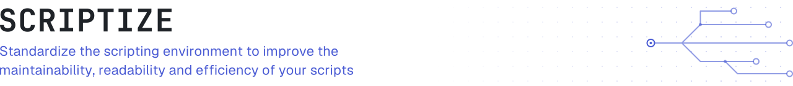
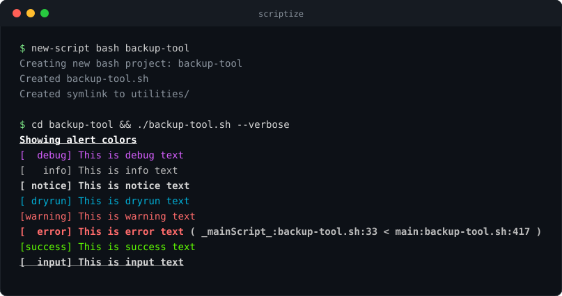

<!-- brand:header:start -->
<picture>
  <source media="(prefers-color-scheme: dark)" srcset="assets/brand/header-371eddd9-dark.svg">
  
</picture>
<!-- brand:header:end -->

<!-- badges:start -->
[](https://www.repostatus.org/#active)
[](https://github.com/JonathanTSilva/scriptize/actions/workflows/ci.yml)
[](https://github.com/JonathanTSilva/scriptize/releases)
[](https://codecov.io/gh/JonathanTSilva/scriptize)
[](https://sonarcloud.io/summary/new_code?id=JonathanTSilva_scriptize)
[](https://scorecard.dev/viewer/?uri=github.com/JonathanTSilva/scriptize)
[](https://www.bestpractices.dev/projects/17181)
[](LICENSE)
[](https://codespaces.new/JonathanTSilva/scriptize)
<!-- badges:end -->

**Stop starting scripts from a blank file.** scriptize gives every Bash or Python script the same safe, readable skeleton: error trapping, flag parsing, leveled colored alerts and logging, on top of a tested utility library. One command scaffolds it.

<p align="center">
  
</p>

*The real output of a freshly generated script. Nothing was added to it.*

## What it is

A set of templates and utilities for Bash and Python scripts, plus a `new-script` helper that scaffolds a new script from them.

- **A Bash template that behaves.** It traps errors and cleans up on exit, parses `--help`, `-v`, `-q`, `-n` (dry run), `--force`, `--logfile` and `--loglevel`, and logs to a file.
- **Eleven Bash utility modules.** Alerts, arrays, checks, dates, debug, files, macOS, misc, services, strings and the template's own helpers. They are documented with `shdoc` and covered by more than 230 bats tests.
- **A Python starter.** It has logging through `rich` with JSON file logs, plus utility modules for checks, CLI alerts, files, shell commands and strings.
- **Docs and a live test report.** API pages are built with mkdocs, and the [test report](https://jonathantsilva.github.io/scriptize/) is rebuilt by CI.

## Quick start

`new-script` is installed system-wide, so the installer needs `sudo`. It records where you cloned the repository, so clone it somewhere you will keep it.

```bash
git clone https://github.com/JonathanTSilva/scriptize.git
cd scriptize && sudo ./install.sh
```

The installer also checks for `shellcheck`, `shfmt` and `bats`, and warns if one is missing. They are optional but worth having:

```bash
sudo apt install shellcheck shfmt bats   # Debian/Ubuntu
sudo dnf install ShellCheck shfmt bats   # Fedora
brew install shellcheck shfmt bats       # macOS (Homebrew)
```

## Usage

Scaffold a script:

```bash
new-script bash my-awesome-tool      # ./my-awesome-tool/my-awesome-tool.sh
new-script python my-data-processor  # ./my-data-processor/my-data-processor.py
```

Each command creates a directory named after your script, holding the executable script and a `utilities/` link to the shared library. Add your logic to `_mainScript_` in a Bash script, or to `main()` in a Python one. The Python starter imports `scriptize`, so run it with the checkout on `PYTHONPATH`.

### Pre-commit hooks

If you keep `.pre-commit-config.yaml`, install pre-commit once per system and the hooks into your git repo (run inside the repo):

```bash
pip install pre-commit
pre-commit install
```

### Generating Bash docs

`scriptize/utils/shdoc` is a self-contained awk script, so it needs no installation. It behaves like the original shdoc. Run it from the root of this repository.

Generate documentation for a single file:

```bash
./scriptize/utils/shdoc < scriptize/assets/bash/utilities/alerts.bash > docs/alerts_api.md
```

Generate a single documentation file for all utilities:

```bash
cat scriptize/assets/bash/utilities/*.bash | ./scriptize/utils/shdoc > docs/BASH_API_REFERENCE.md
```

## Docs

- API reference: [`docs/`](docs/index.md), built with mkdocs.
- Test report: <https://jonathantsilva.github.io/scriptize/>

## Contributing

Read the [contribution guide](https://github.com/JonathanTSilva/.github/blob/main/CONTRIBUTING.md) first. To work on the Python code:

```bash
uv sync
uv run pytest
```

The Bash utilities are tested with bats, see [`.github/workflows/shell.yml`](.github/workflows/shell.yml) for how the tests are staged.

## License

[MIT](LICENSE)

<!-- brand:footer:start -->
<p align="right"><a href="https://www.jontobias.com"><picture>
  <source media="(prefers-color-scheme: dark)" srcset="https://raw.githubusercontent.com/JonathanTSilva/.github/main/assets/brand/jontobias-dark.svg">
  
</picture></a></p>
<!-- brand:footer:end -->
